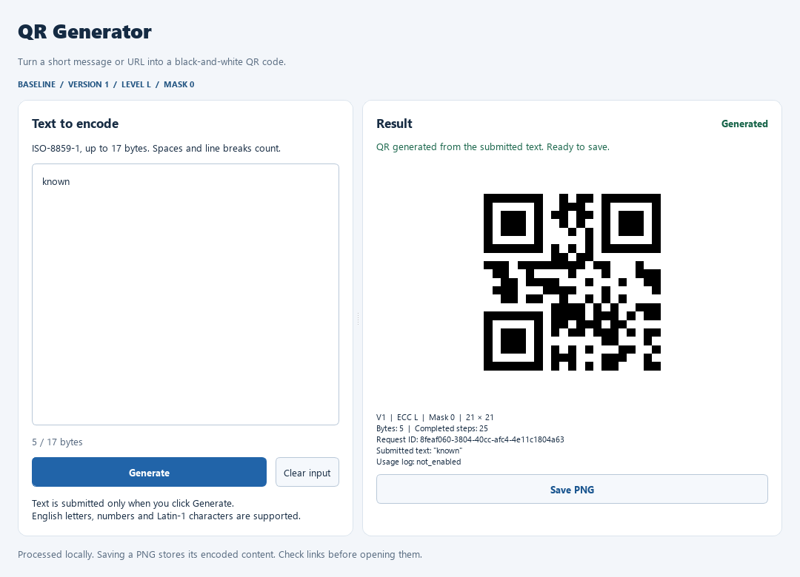
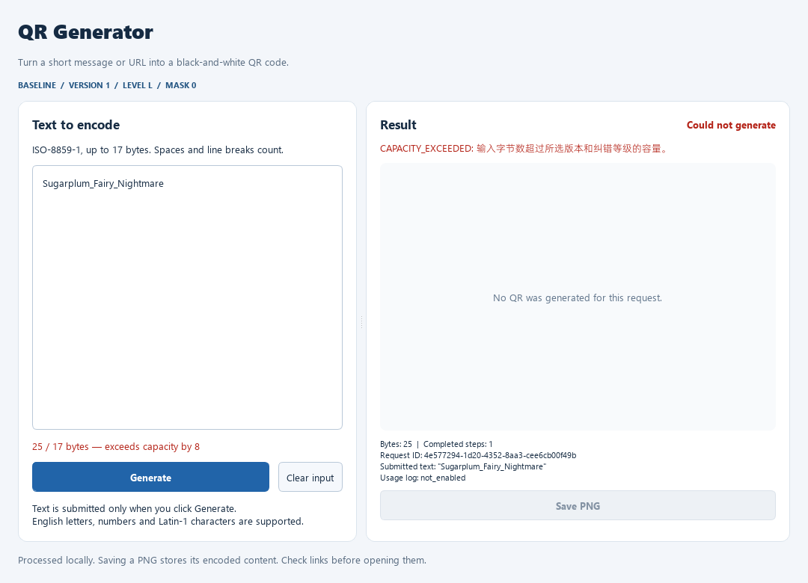

# PyQt5 正式文本输入与生成页面

日期：2026-11-12。状态：Stage2基础生成页面、渲染和PNG保存已实现，[Information](information.md)也已接入。个人扩展页面、手机扫码与教学机房验收仍待完成。

## 1. 启动与操作

在项目根目录使用已有 `.venv`：

```powershell
& '.\.venv\Scripts\python.exe' -X utf8 main_gui.py
```

在编辑器中运行时，选择项目 `.venv\Scripts\python.exe` 为解释器，打开根目录 `main_gui.py` 后运行。程序打开后：

1. 在 **Text to encode** 文本框输入文字。
2. 查看实时字节数及字符/容量提示。
3. 点击 **Generate**，右侧显示当前请求的二维码、实际参数和结果信息。
4. 点击 **Save PNG** 选择位置；已有文件需要确认覆盖。
5. **Clear input** 只清空输入草稿，保留上次提交记录及其结果标识。

可以预填文字，但仍须点击 Generate 才会提交：

```powershell
& '.\.venv\Scripts\python.exe' -X utf8 main_gui.py --text "known"
```

原有 `main_cli.py` 和 `scripts/preview_qr.py` 继续保留。需要在窗口中输入并生成时使用 `main_gui.py`。

## 2. 基础规则

| 项目 | 当前实现 |
|---|---|
| 模式 | 固定 V1 / Level L / Mask0 / Byte |
| 字符集 | 严格 ISO-8859-1，最多 17 字节 |
| 输入框 | 多行纯文本，不截断、不 trim、不替换不支持字符 |
| 输入保真 | 保留首尾空格、TAB、Latin-1 不间断空格；GUI 段落换行按 LF 提交 |
| 输入提示 | 实时字节数；不支持字符的 Unicode 码点和从 0 开始的位置；超容量字节数 |
| 提交时机 | 只有点击 Generate 才创建请求并调用服务 |
| 图片 | 黑白、正方形比例、至少 4 模块白边 |
| 保存 | 使用当前图像，不重新编码、不创建另一个请求 |
| 说明 | 提示本地处理、PNG 含编码内容及检查链接的风险 |

字节提示只是编辑辅助；点击 Generate 后仍由 QRService 执行最终校验。空输入、不支持字符和超容量会形成真实失败请求，并显示已完成步骤数。

Qt 的普通 `toPlainText()` 会把不间断空格转换成普通空格。本页按文档块读取文本，避免改变可编码的 Latin-1 字节。

## 3. 页面与实现位置

| 文件 | 职责 |
|---|---|
| [main_gui.py](../main_gui.py) | 薄启动入口，导入时不创建窗口 |
| [gui.py](../qr_app/presentation/gui.py) | 参数、Qt 环境、高 DPI、QApplication 和事件循环 |
| [main_window.py](../qr_app/presentation/main_window.py) | 主窗口、页面容器、滚动、自适应布局和窗口样式 |
| [generation_panel.py](../qr_app/presentation/generation_panel.py) | 文本、字节提示、提交、结果状态、画布和保存事件 |
| [qt_environment.py](../qr_app/presentation/qt_environment.py) | 中文路径的 Qt 插件定位；Windows 离屏模式字体目录 |

GUI 使用 `QRService.generate_qr(QRRequest(..., source="gui"))`，没有另一套编码算法。生成页面持有一个 Figure、Axes 和 Qt 画布，后续请求更新原画布；窗口关闭时释放这些对象。

界面当前提供Generate QR和Information两个实际页签，没有显示尚未接入的扩展选项或空白页签。Information可用F1打开，返回后保留输入及结果状态。

## 4. 状态与旧结果保护

| 状态 | 展示与操作 |
|---|---|
| Empty | 未提交请求，保存禁用 |
| Editing | 输入为草稿；有旧结果时明确显示 previous submission / Not updated，保存禁用 |
| Generating | 生成、清空、保存禁用，输入框只读；防止处理中重入 |
| Success | 显示实际结果，当前输入与提交一致时允许保存 |
| Failure | 显示真实错误与已完成步骤；清除旧图并禁用保存 |
| Display error | 核心生成成功但绘图失败；保留生成结果事实，显示独立图像错误并禁用保存 |

修改文字不会自动生成。若把草稿恢复为同一份已成功提交的原文，会恢复该结果的保存能力，不再次调用服务。

Clear input 只清空草稿，不删除已提交的请求对象、结果或文件。旧图保留时有明确的未更新提示；点击 Generate 后旧图先清除，新请求失败也不会再显示旧图。

业务失败保留输入，按钮恢复可用，可以直接修正后重试。服务异常、绘图异常和意外保存异常均显示安全提示，不把内部路径或异常堆栈放入界面。

使用日志由服务负责。当前默认未装配日志扩展；若后续注入的日志器失败，独立警告不会把二维码生成成功改成失败，也不会由 GUI 再补写一条日志。

## 5. 保存行为

Save PNG 复用[已有保存器](png_export.md)。保存取消、拒绝覆盖或写入失败，均保留本次生成结果和画布；可以重试。保存期间暂时锁定会影响当前请求的控件。

窗口显示的参数和保存图像均属于同一份已提交结果。草稿与当前结果不一致时，保存禁用。

## 6. 布局和环境处理

默认窗口为 1080×780，输入与结果分区可拖动调整。默认成功状态下 Generate 和 Save PNG 均在可见区域内；小窗口通过滚动到达全部内容，不强制拉伸二维码。

本次视觉检查修复了两项问题：

- Qt Windows 离屏平台不能通过损坏的默认安装路径找到字体，现仅在本进程的 Windows/offscreen 模式中指定已有系统字体目录。
- matplotlib 画布的上一帧像素尺寸会反馈为 Qt sizeHint，现由页面布局决定画布空间，避免成功结果把默认窗口撑高。

这些设置不修改 Windows 系统配置。原有插件 Unicode 路径处理继续保留。

## 7. 验证

[gui_generation_python3139_20261112.json](validation/gui_generation_python3139_20261112.json) 保存真实测试输出、源码哈希、交互检查、图片哈希及本机解码输出。

GitHub上传前另存[发布前复验记录](validation/gui_generation_pre_publish_python3139_20261112.json)，50项测试、Qt交互、图像解码与编译全部通过。
复验还通过真实输入框和生成按钮确认：`Hello\nQR`的分隔字节为`0A`，`Hello QR`为`20`，对应矩阵不同；实现保持不变。
该记录提供按仓库LF换行计算的`repository_source_sha256`供提交后核对，旧记录与截图保留。

### 7.1 五十项前端测试

```powershell
& '.\.venv\Scripts\python.exe' -X utf8 -m unittest tests.test_gui_generation tests.test_image_export tests.test_png_dialog tests.test_renderer -v
```

实际执行 **50 项**，全部通过、无跳过：新增 GUI 19 项，保存/对话框/渲染回归 31 项。本次未重跑 Stage 1 的 139 项历史测试。

GUI 场景涵盖首次打开、预填不提交、输入提示、空格/换行/TAB/不间断空格保真、真实生成、草稿变化、清空和恢复、失败清旧图、重复提交身份隔离、处理中重入保护、日志故障、绘图故障、保存取消/异常、真实保存及窗口大小。

### 7.2 实际事件循环与图像

使用真实离屏 Qt 事件循环完成：输入 known → Generate → Save PNG → 修改草稿 → Clear input → 容量错误 → 17 字节成功恢复。

文件选择与消息框使用预设响应；此测试不代替原生文件对话框的人工操作。保存没有新增生成请求，画布被复用，失败时旧图清除。

本机 OpenCV 4.12.0 从完整成功窗口截图和实际保存 PNG 中均解码出 `known`。OpenCV 只用于既有解释器的离线验证，不增加应用依赖。

### 7.3 页面截图

成功状态：



失败状态：



## 8. 后续验收

Information及信息模型、完整性、安全说明现已实现，详情及58项前端回归见[Information说明](information.md)；原生成阶段的50项记录保留为历史。

- Windows 原生窗口、文件对话框、不同系统缩放比例的人工操作验收。
- 手机扫描屏幕和保存 PNG、教学机房复现。
- Stage 2 文档化验收之后的四项个人扩展。

测试用的离屏启动方式：

```powershell
& '.\.venv\Scripts\python.exe' -X utf8 main_gui.py --offscreen --close-after-ms 1000
```

正常使用不需要这些测试参数，也不会自动关闭窗口。
