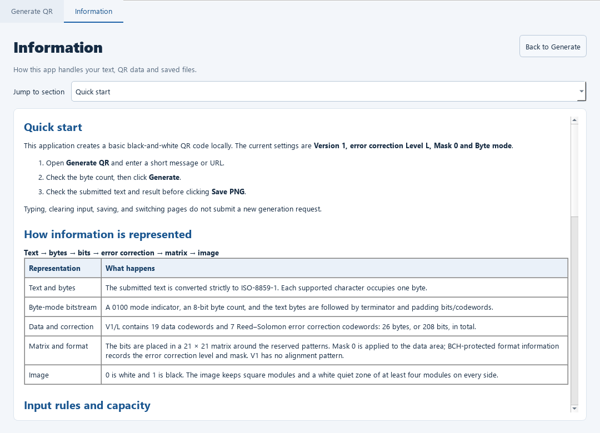
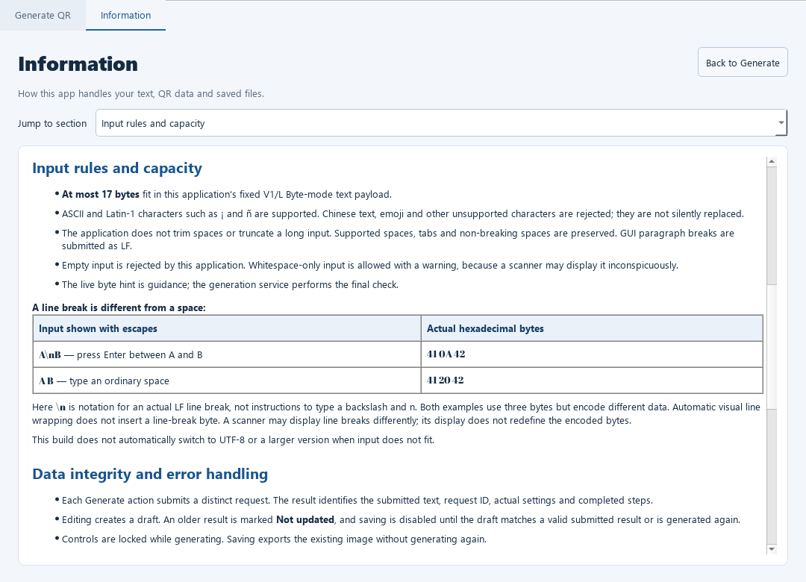
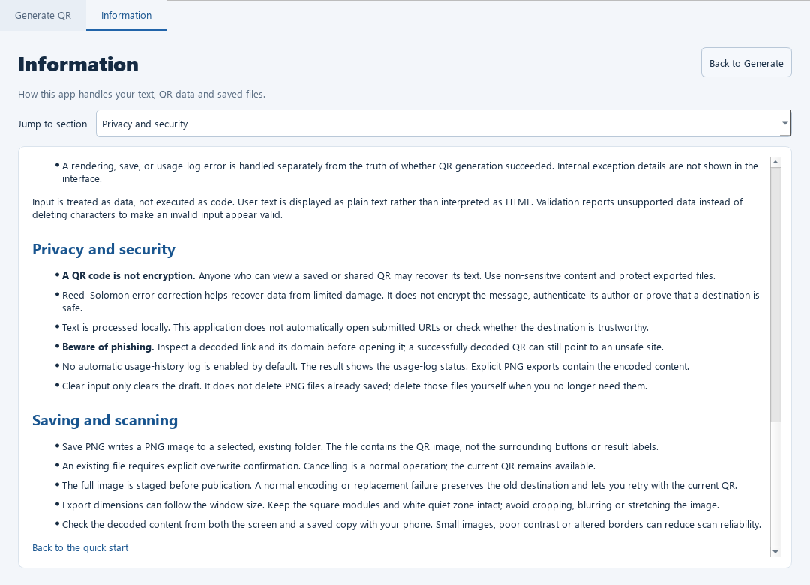

# Information 页面

日期：2026-11-12。状态：Stage 2 的 Information 功能已实现，并接入正式桌面应用。

## 1. 如何打开

```powershell
& '.\.venv\Scripts\python.exe' -X utf8 main_gui.py
```

- 默认打开 **Generate QR**。
- 点击顶部 **Information** 页签，或按 **F1** 打开说明。
- 使用 **Jump to section** 下拉框跳转到指定内容。
- 点击 **Back to Generate** 或 Generate QR 页签返回输入与结果。
- 文档末尾的 **Back to the quick start** 返回说明顶部。

页签切换、阅读和分节导航均不会创建生成请求、写使用日志或重新编码。

## 2. 内容与要求

页面为当前真实基础实现提供说明，没有把个人扩展写成已完成功能。

| 分节 | 用户能了解什么 |
|---|---|
| Quick start | 输入、检查字节数、Generate、核对结果与 Save PNG；当前固定 V1/L/Mask0/Byte |
| How information is represented | 文本→ISO-8859-1字节→模式/长度/正文位流→数据和纠错码字→21×21矩阵→格式与掩码→图像 |
| Input rules and capacity | 17字节上限、字符支持、空输入与空白、LF换行0A和空格20、视觉折行与真实换行 |
| Data integrity and error handling | 草稿与提交的区别、旧结果保护、失败清图、真实步骤、生成/绘图/保存/日志的独立状态 |
| Privacy and security | 本地处理、默认未启用使用历史日志、PNG内容可被读取、纠错不是加密或认证、链接与钓鱼风险 |
| Saving and scanning | PNG与已有文件覆盖、取消和失败、白边及比例、保存后扫码核对 |

信息模型提供当前实际数值：19个数据码字、7个RS纠错码字、26字节/208位、21×21主体以及至少4模块白边。

输入示例用明确的十六进制区分：`A\nB`的实际换行数据是`41 0A 42`，`A B`是`41 20 42`。页面说明这里的`\n`是转义记法，不是让用户键入反斜杠和n。

## 3. 数据保护与只读行为

Information 内容来自固定的可信说明，没有插入用户输入。用户在生成页输入的HTML样式文字不会改变说明文档。

页面使用只读 QTextBrowser，关闭自动链接打开和拖入内容，只处理已知的页内锚点；外部网址、文件地址、邮件链接及文档资源均不加载。它不会启动浏览器或访问输入URL。

生成页的草稿、已提交请求、实际结果、画布和保存能力在切页前后保持原有含义：

- 成功结果返回后仍可保存。
- 修改过的草稿仍被标记为未更新，保存仍禁用。
- 失败结果仍显示其错误与已完成步骤，旧图不会恢复。
- 保存使用已有图像，不再次调用生成服务。

## 4. 文件结构

| 文件 | 职责 |
|---|---|
| [information.py](../qr_app/presentation/information.py) | 说明内容、只读浏览器、分节选择及返回信号 |
| [main_window.py](../qr_app/presentation/main_window.py) | Generate QR / Information 两个真实页签、F1及返回连接 |
| [test_information.py](../tests/test_information.py) | 导航状态、只读、资源保护及返回后保存的行为验证 |

主窗口仍保留 `generation_panel`，生成页滚动容器为 `generation_scroll`，中央组件改为 `tabs`。这是展示层的组合变化，QRRequest、QRService、渲染器及保存器的接口没有改变。

## 5. 验证结果

实际记录：[information_python3139_20261112.json](validation/information_python3139_20261112.json)。包含真实测试输出、源码与图片哈希、Qt交互及本机解码输出。

### 5.1 五十八项前端测试

```powershell
& '.\.venv\Scripts\python.exe' -X utf8 -m unittest tests.test_information tests.test_gui_generation tests.test_image_export tests.test_png_dialog tests.test_renderer -v
```

**58项全部通过，无跳过**：Information新增8项，加上原有生成/渲染/保存50项回归。本轮没有重跑Stage1的139项历史测试。

新增场景包括：

1. 未提交时打开和关闭Information，不生成请求。
2. 多次分节及返回后，成功请求、二维码、画布和保存能力保持一致。
3. 草稿及失败状态不因切页变成成功。
4. 页内导航可滚动，返回首节确实回到顶部。
5. 外部网址、文件及嵌入资源不会被打开。
6. 说明只读，用户输入的HTML文字不进入说明文档。
7. 返回后真实导出PNG，且不重新生成。
8. 输入框中按F1可打开Information。

### 5.2 真实Qt事件循环

离屏窗口实际完成：打开Information → 阅读快速开始/输入规则/隐私安全 → 返回 → 生成known → 再切页并返回 → Save PNG → 修改草稿 → 再次切页并保留未提交状态。

过程中仅有一次Generate请求；说明导航和保存没有增加请求。原生文件对话框和消息框使用预设响应，不代替人工操作验收。

本机OpenCV 4.12.0从含有新页签的生成窗口截图和实际保存PNG中均解码出known。OpenCV仍只用于离线验证，不增加应用依赖。

### 5.3 页面截图

总览：



输入规则与换行/空格：



隐私与安全：



## 6. 后续验收

生成、显示、PNG保存和Information已经具备本机实现与证据。下一步进行Windows原生控件、显示缩放、手机扫码及教学机房复现，整理Stage2完整验收记录；这些人工项目尚未在本次自动检查中完成。

后续个人扩展接入时，需要根据真实版本、纠错、掩码及日志能力同步Information，保持说明与实际行为一致。
