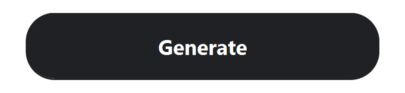

# 按钮果冻回弹

本功能位于 `feature/soft-minimal-ui`。重启正式应用即可使用，无需安装新依赖。

```powershell
& '.\.venv\Scripts\python.exe' -X utf8 main_gui.py
```

Generate、Save PNG、Clear input 使用同一个 `JellyButton` 组件。按下时轻微压缩，松开后做一次约 250 ms 的回弹；Generate 的幅度稍明显，其他两个按钮更轻。快速连续点击会接续当前绘制状态，不叠加动画实例或额外提交。



## 行为

- 只在按钮上安装绘制效果，原有几何尺寸、布局和点击区域不变；回弹可绘制到按钮边缘外的少量空间。
- 业务处理仍由原来的 Qt 点击信号立即触发，不等待动画结束。鼠标和空格键均可使用。
- Generate 与 Save PNG 在业务处理期间暂停并复位，处理完且恢复可用后回弹。同步生成期间不承诺动画持续刷新。
- Clear input 清空后会禁用，因此直接复位，不在禁用状态下继续回弹；之后输入新文字不会补播旧动画。
- 移出原点击区域后松开，取消提交并恢复正常外观；焦点离开、隐藏页面或关闭窗口时复位。
- 生成、保存期间暂时将焦点停放在没有焦点边框的容器上，完成后恢复到原操作按钮；Clear input 清空后焦点回到输入框。避免 Qt 自动将焦点转到 Input rules，同时保留正常 Tab 导航的蓝色焦点提示。
- 弹窗、侧栏和二维码画布没有加入动画，PNG 导出沿用原实现。

关闭按钮动效：

```powershell
& '.\.venv\Scripts\python.exe' -X utf8 main_gui.py --reduced-motion
```

该选项只控制本应用的按钮动画，不依赖系统设置。组件也提供 `set_motion_enabled(False)` 供后续界面设置调用。

## 实现与验证

`qr_app/presentation/jelly_button.py` 复用 QPushButton 的点击与键盘行为，使用独立 QGraphicsEffect 变换绘制层。QPropertyAnimation 控制压缩与回弹，动画组复用，启用、禁用、忙碌和隐藏状态会停止不合适的动画。`generation_panel.py` 负责同步业务忙碌状态，`gui.py` 提供关闭动画的启动参数。

69 项前端相关测试通过，含 7 项新交互测试：压缩与回弹、快速点击、空格键、移出后取消、模态保存、禁用后编辑、关闭动效及切页复位。原有生成、Information、PNG 保存和渲染测试继续通过。

Windows 原生隐藏窗口另外验证了实际压缩/回弹、固定几何尺寸、Save PNG 的较轻回弹、Clear input 禁用时复位、关闭动画及二维码像素不变。动图由真实控件逐帧采集；配置 `QT_SCALE_FACTOR=1.6`，本机叠加系统缩放后的实际像素比约 3.2。它用于展示控件行为，不替代不同显示器上的人工体验。

[验证记录](validation/jelly_buttons_20261112.json) · [测试输出](validation/jelly_buttons_tests_20261112.txt) · [静态状态对比：正常、压缩、回弹峰值](validation/jelly_button_states_20261112.png)

后续焦点修复另通过 40 项相关测试，新增生成成功/失败后的焦点恢复、空格键重复生成、Tab 到规则入口、保存恢复焦点和清空后继续输入检查。动画像素比较在相同焦点状态下进行，以排除焦点边框宽度变化。[焦点修复记录](validation/action_focus_20261112.json)保留修复前后的实际焦点事件和本轮测试结果。
