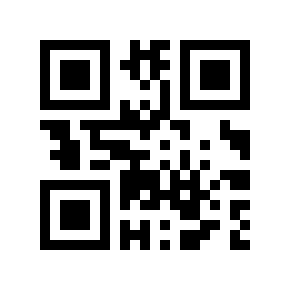

# matplotlib 二维码渲染

日期：2026-11-12。状态：Stage2矩阵渲染、PNG保存、[正式输入窗口](gui_generation.md)及[Information](information.md)已实现；手机扫码仍待人工验收。

## 1. 本次实现

实现文件：[renderer.py](../qr_app/presentation/renderer.py)。渲染器接收已有的二维数值矩阵，添加显示所需的 white quiet zone，再通过 matplotlib 绘制黑白正方形模块。

| 内容 | 当前行为 |
|---|---|
| 黑白映射 | 0 为白，1 为黑，使用固定颜色映射 |
| 白边 | 默认四周各 4 模块，可增大，不允许小于 4 |
| 默认缩放 | 初始每模块 10×10 像素 |
| 方向 | 数组第 0 行位于顶部，不转置、不翻转 |
| 插值 | nearest，不使用平滑重采样 |
| 比例 | 横纵数据单位等长；宽窗口中保持正方形并居中 |
| 修饰 | 无坐标轴、刻度、网格或内嵌标题 |
| 原矩阵 | 不修改、不补写白边；显示数据使用独立存储 |
| 副作用 | 渲染模块不创建 Qt 应用、不打开窗口、不自动写文件 |

V1 主体是 21×21，增加四周各 4 模块后为 29×29。默认初始图像为 290×290 像素，其中白边各 40 像素。

## 2. 接口

### 2.1 RenderOptions

```python
from qr_app.presentation.renderer import RenderOptions

options = RenderOptions(quiet_zone_modules=4, module_pixels=10)
```

它是不可变的数据类。两个字段必须是 Python 整数，不能使用 bool、浮点数或字符串；白边至少为 4，模块像素数必须为正数。

### 2.2 render_qr(matrix, render_options=None) -> Figure

创建新的独立 matplotlib Figure，默认使用 RenderOptions()。Figure 初始边长：

```text
(主体模块数 + 2 × quiet_zone_modules) × module_pixels
```

内部使用 128 DPI，保证这里的整数像素尺寸可以由浮点数精确表示，避免画布取整导致整张图纵向偏移一像素。用户调整的是 module_pixels，不需要手工指定 DPI。

这个函数不通过 pyplot 创建窗口，也不选择全局后端。调用方可以挂接 Agg 画布进行离屏绘图，或挂接 FigureCanvasQTAgg 在窗口显示。

### 2.3 draw_matrix(axes, matrix, render_options=None) -> None

在调用方提供的 Axes 中绘图。它会清理并替换该 Axes 的旧内容，不改变同一 Figure 中其他 Axes，也不改变 Figure 的尺寸。

GUI 的窗口和布局控制实际显示大小，所以此接口中 module_pixels 不会强制改变画布尺寸；它只在 render_qr 创建 Figure 时决定初始像素大小。窗口缩放时仍保持正方形比例和完整白边。

所有输入验证都先于清理操作。输入无效时抛出异常，已有画面保持不变。

## 3. 输入和异常

接受非空、正方形、二维 numpy 数组；dtype 为整数或 bool，元素只能是 0/1。既支持服务返回的只读 uint8 主体，也支持非连续整数视图。

| 情况 | 结果 |
|---|---|
| None、普通嵌套列表、浮点/字符串/object 数组 | TypeError |
| 非二维、非正方形、空数组、含 -1 或 2 等值 | ValueError |
| render_options 不是 RenderOptions 或 None | TypeError |
| draw_matrix 的 axes 不是 matplotlib Axes | TypeError |
| 白边少于 4 或缩放不为正 | ValueError |

绘图函数只验证绘图所需的数据结构，不判断任意输入是否包含合法的 QR 编码。正常应用应使用 `QRService` 的成功结果，不把中间布局当作最终二维码。

## 4. 从服务取得矩阵并绘图

```python
from matplotlib.backends.backend_agg import FigureCanvasAgg
from qr_app.models import QRRequest
from qr_app.service import QRService
from qr_app.presentation.renderer import RenderOptions, render_qr

result = QRService().generate_qr(QRRequest(text="known"))
if not result.generation_success:
    raise ValueError(result.error_message)

figure = render_qr(result.matrix, RenderOptions(module_pixels=10))
canvas = FigureCanvasAgg(figure)
canvas.draw()
pixels = canvas.buffer_rgba()
print(pixels.shape)  # (290, 290, 4)

# 调用方用完后释放；挂在 Qt 上时由窗口管理 Figure 生命周期。
figure.clear()
```

这里生成的是内存画布。独立保存接口现已实现，见[PNG保存说明](png_export.md)；生成矩阵成功和保存成功分别表达。

## 5. 直接打开真实二维码预览

预览入口：[scripts/preview_qr.py](../scripts/preview_qr.py)。在项目根目录使用已准备的 `.venv`：

```powershell
# 默认显示 known，手动关闭窗口
& '.\.venv\Scripts\python.exe' -X utf8 scripts/preview_qr.py

# 传入支持的文本
& '.\.venv\Scripts\python.exe' -X utf8 scripts/preview_qr.py --text "https://a.co"

# 增大白边和初始模块像素，10秒后自动关闭
& '.\.venv\Scripts\python.exe' -X utf8 scripts/preview_qr.py --text "known" --quiet-zone 6 --module-pixels 12 --close-after-ms 10000

# 不显示窗口，实际创建Qt画布并自动关闭
& '.\.venv\Scripts\python.exe' -X utf8 scripts/preview_qr.py --text "known" --offscreen
```

预览复用基础 V1/L/Mask0 和严格 ISO-8859-1，容量仍为 17 字节。它先检查生成结果，业务失败时显示错误与完成步骤数，不创建窗口。退出码0表示正常关闭或保存成功，1表示生成失败，2表示参数错误，3表示--png-out保存失败。

Qt启动复用前一步的Unicode插件路径处理。预览窗口包含二维码、实际参数说明和Save PNG按钮，还没有文本输入框、生成按钮或Information页面。
终端也支持`--png-out PATH --no-preview`直接保存，覆盖需加`--overwrite`；见[保存用法](png_export.md)。

## 6. 验证

实际记录：[renderer_python3139_20261112.json](validation/renderer_python3139_20261112.json)。记录中保存了执行命令、输出、退出码、源码 SHA-256 和验证图片哈希。

上述渲染记录对应加入保存前的预览脚本，保留为历史。当前保存版本另有[31项测试及保存验证](validation/png_export_python3139_20261112.json)，不以旧脚本哈希证明新代码。

GitHub上传前已另存[发布前复验记录](validation/renderer_pre_publish_python3139_20261112.json)：13项专项测试、五张图的本机解码、Qt离屏预览、三类预览错误及编译再次通过，已有公开验证图与复验生成图的哈希一致。
该记录同时保留实际工作文件的`source_sha256`和按仓库LF换行计算的`repository_source_sha256`，后者可用于核对提交后的文件；原有记录不改写。

### 6.1 十三项专项测试

```powershell
& '.\.venv\Scripts\python.exe' -X utf8 -m unittest tests.test_renderer -v
```

已通过的检查包含：

- 非对称图案逐像素检查方向、黑白颜色和白边。
- 使用独立静态 known 参考矩阵核对整张 290×290 图像。
- 每模块 1、3、7、10 像素，以及增大白边后的精确尺寸。
- 原数组可写或只读时均不修改；后续请求和原数组变化不影响前一张图。
- 用户修改 matplotlib 默认配色、方向、网格或布局时，仍维持正确二维码。
- 更新单个 Axes 时不清空其他 Axes；重复绘图不叠加图片。
- Figure 拉宽后图案仍居中、模块等比例、白边完整且背景为白色。
- 非法矩阵、参数和 Axes 被明确拒绝；失败不清掉旧图。
- 导入渲染器不加载 Qt、pyplot、qrcode 或 OpenCV。

只安装基础 requirements.txt 的环境若没有 matplotlib，渲染专项测试会明确跳过。GUI 环境应安装 requirements-gui.txt；本次 13 项均实际执行并通过，没有跳过。未重新运行 Stage 1 的 139 项历史测试。

### 6.2 真实样例与本机解码

以下五张图均实际渲染为黑白、不透明的 290×290 图像，本机已有的 OpenCV 4.12.0 均成功解码，结果与输入一致：

| 输入 | 结果 |
|---|---|
| `known` | 通过 |
| `We've succeeded!` | 通过 |
| `~¡256_-_aA&ñ` | 通过 |
| 17 个 `A` | 通过 |
| 一个空格 | 通过 |

OpenCV 只在原有解释器中用于离线验证，未加入应用依赖。Latin-1 样例在二维码内仍按 ISO-8859-1 编码；验证记录中的 decoded_utf8_hex 是 OpenCV 返回文本的 UTF-8 表示。

Qt 离屏预览也实际通过，包括绘图和自动关闭；不支持字符、超容量及非法白边分别得到预期错误。

### 6.3 验证图



该PNG是渲染阶段显式写出的公开样例制品。渲染器本身仍没有写入副作用；独立PNG保存已实现，其[真实导出样例](validation/png_saved_known_20261112.png)与该图像素一致。真实手机扫码与教学机房验收尚未执行。
