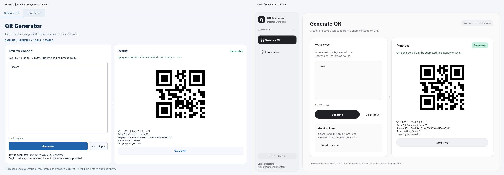

# 柔和极简桌面界面

本次依据 `F:/文件/收藏/视觉语言/Soft_Minimalism_UI_Design_Language.md` 的视觉原则，使用现有 PyQt5 实现重新排版，没有增加第三方依赖。新旧版本分支独立保留，不合并旧版、不重写历史。

## 版本与对比

| 版本 | 分支 | 基准 |
|---|---|---|
| 旧界面 | `feature/stage2-gui-environment` | `c7bae6ab1c3e2531504f36fe335e893cd257ca97` |
| 新界面 | `feature/soft-minimal-ui` | 从上述提交建立，包含本次界面重排 |

相同输入 `known`、相同 1240×820 窗口、同一项目解释器的对比，左旧右新：



## 已实现

- 冷灰底色、近白工作区、白色卡片，统一圆角、间距、字号与状态配色。
- 左侧 Generate QR / Information 导航，支持手动折叠；窗口宽度小于 1000 时自动压缩为图标导航，提供提示和可访问名称。
- 输入与预览两张卡片；深灰 Generate、次级 Save PNG、轻量 Clear input 和 Input rules。
- 输入卡片单层轻投影；自绘矢量线性图标，不使用外部图标资源。
- 页面宽度小于 740 时输入与结果上下排列，小窗口纵向滚动；默认窗口生成后直接显示生成与保存按钮。
- Information 使用相同主题，保留分节跳转、返回和 F1；Input rules 可直接跳到输入规则。
- 键盘焦点、悬停、按下、禁用、选中态以及成功、错误、草稿状态仍有清晰反馈。
- 原生启动时依据可用屏幕区域限制初始窗口尺寸。

编码、PNG 保存接口、单次点击单次请求、旧结果失效规则和隐私行为均沿用原实现。换行仍保留为 LF（`0A`），普通空格仍为 `20`，不合并或去除空白；基础限制仍为 ISO-8859-1、17 字节、V1/L/Mask0。二维码主体保持纯黑白和原有静区。

多层内阴影、背景模糊和复杂过渡动画暂缓。系统文件选择与提示对话框继续使用 Qt 标准交互。

## 运行并比较

以下命令均在项目根目录的 PowerShell 执行。使用项目 `.venv`，不用重新安装环境。

新版：

```powershell
& '.\.venv\Scripts\python.exe' -X utf8 main_gui.py
```

本机已在 `tmp/ui_previous` 创建旧提交的独立工作目录，处于 detached HEAD，可以从另一个终端启动旧版，同时与新版对比：

```powershell
& '.\.venv\Scripts\python.exe' -X utf8 '.\tmp\ui_previous\main_gui.py'
```

`tmp/ui_previous` 不纳入仓库提交。其他电脑或此目录被清理后，可以在目录不存在时重建：

```powershell
git worktree add --detach tmp/ui_previous c7bae6ab1c3e2531504f36fe335e893cd257ca97
```

## 切回旧版

本次改版独立提交在新分支。关闭窗口，确认 `git status --short` 没有未保存改动，再执行：

```powershell
git switch feature/stage2-gui-environment
& '.\.venv\Scripts\python.exe' -X utf8 main_gui.py
```

重新使用新版：

```powershell
git switch feature/soft-minimal-ui
& '.\.venv\Scripts\python.exe' -X utf8 main_gui.py
```

若之后又改过代码，应先保存到提交或暂存，再切分支。无需 reset，也无需删除任何版本。本轮保存为本地提交，未自动上传或合并。

## 实现位置

| 文件 | 用途 |
|---|---|
| `qr_app/presentation/theme.py` | 共享颜色、圆角、间距和 QSS / 富文本样式 |
| `qr_app/presentation/icons.py` | 矢量图标及透明像素初始化 |
| `qr_app/presentation/navigation.py` | 两页侧栏、选中状态、折叠和提示 |
| `qr_app/presentation/main_window.py` | 工作区容器、导航同步、窄窗口侧栏 |
| `qr_app/presentation/generation_panel.py` | 输入/预览卡片、规则入口和响应式重排 |
| `qr_app/presentation/information.py` | 信息页面主题、分节控件和窄窗口标题 |
| `qr_app/presentation/gui.py` | 原生启动时按屏幕大小约束初始窗口 |

## 验证与边界

2026-11-12，Windows / 项目 Python 3.13.9 / PyQt5 5.15.11 / Qt 5.15.2 / matplotlib 3.10.7：

- 62 项前端相关测试通过，无跳过：原有 58 项及新增 4 项导航、折叠、窄窗口、规则入口测试。
- Qt 离屏事件循环完成新旧生成/保存、Information、错误和窄窗口截图；默认窗口无滚动溢出，480 宽窗口无横向滚动。
- 新旧两张窗口图和两张导出图分别经 OpenCV 4.12.0 解码为 `known`。
- 与旧提交逐路径比较，核心、模型、服务、规格资源、渲染、PNG 导出及保存对话框均无改动。
- 旧工作目录干净；保留源码、设计规范和制品 SHA-256 及原始测试输出。

本次未重跑 Stage1 历史全量测试；离屏检查不等于新版原生显示缩放、手机扫码或教学机房人工验收。

运行回归测试：

```powershell
& '.\.venv\Scripts\python.exe' -X utf8 -m unittest tests.test_soft_ui tests.test_information tests.test_gui_generation tests.test_image_export tests.test_png_dialog tests.test_renderer -v
```

[验证记录](validation/soft_minimal_ui_python3139_20261112.json) · [测试输出](validation/soft_ui_tests_20261112.txt) · [新版生成页](validation/soft_ui_new_generate_20261112.png) · [Information](validation/soft_ui_new_information_20261112.png) · [错误状态](validation/soft_ui_new_error_20261112.png) · [窄窗口输入](validation/soft_ui_new_narrow_20261112.png) · [窄窗口结果与保存](validation/soft_ui_new_narrow_bottom_20261112.png)
