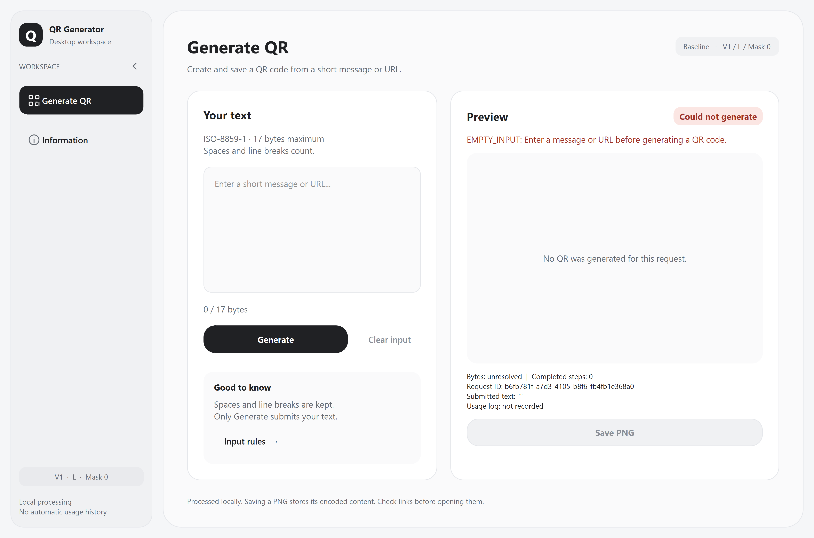
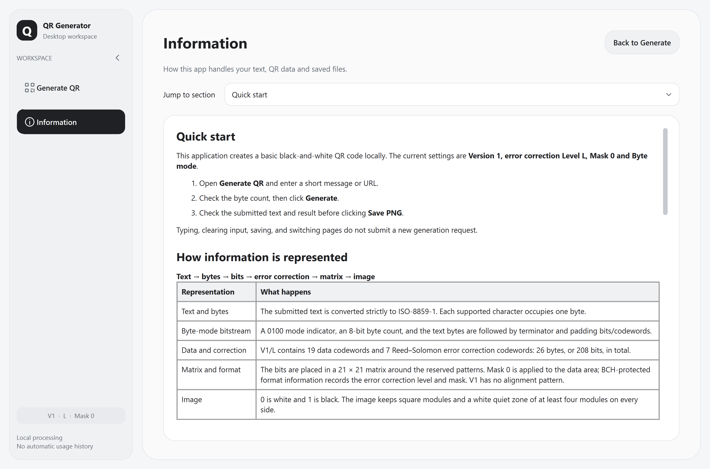
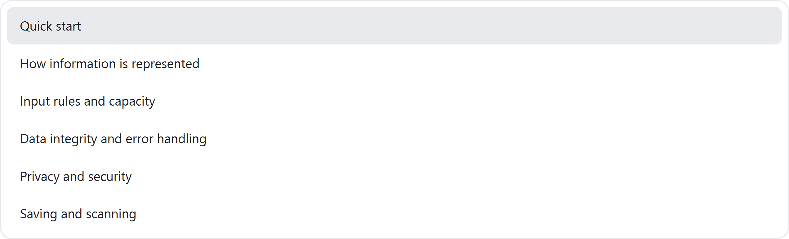

# 控件与英文提示修复

根据实际运行截图调整 `feature/soft-minimal-ui`，并将英文提示修复单独同步到 `feature/stage2-gui-environment`。两个布局和原有提交历史继续保留。

## 新版视觉调整

- 去掉输入卡片投影，让两张卡片以细边框和留白区分。
- 显式设置 QSplitter 和拖动手柄为透明，清除 Windows 系统默认灰色竖条；仍可拖动调整两张卡片的比例。
- 统一页面、文本框、Information 与下拉列表的滚动条：透明轨道、圆头滑块、悬停和按下反馈，去掉系统箭头及方形轨道。
- 下拉框使用本地矢量箭头，移除原生箭头按钮边框；下拉列表统一圆角、留白与选中项背景，保留键盘、滚轮、Enter 和 Esc 操作。

## 新旧版共用的英文提示

新增 `qr_app/presentation/gui_messages.py`，以服务错误码选择英文说明。保留 `EMPTY_INPUT` 等错误码，便于定位错误。

| 场景 | 界面说明 |
|---|---|
| 空输入 | Enter a message or URL before generating a QR code. |
| 不支持的字符 | Some characters are not supported. Use ISO-8859-1 text. |
| 超容量 | Text exceeds the QR capacity. Shorten it and try again. |
| 纯空白 | The input contains only whitespace. Some scanners may not display it clearly. |
| 日志失败 | Usage log could not be written. Statistics may not include this request. |

PNG 保存失败也显示英文，提示检查现有目录、`.png` 文件名、文件占用和写入权限。界面不直接显示内部诊断原文；未知错误使用英文通用提示。

这些转换只作用于桌面展示，QRResult 中原始错误与警告、错误码、CLI 以及编码规则都保持不变。旧版没有引入新版主题。

## 验证

- 新版 62 项、旧版 58 项前端相关测试全部通过，无跳过。增强现有断言，覆盖英文错误、警告去重、原始结果保留及 PNG 失败提示。
- Qt 离屏检查覆盖 100% / 160% 缩放；Windows 平台的隐藏窗口另完成 160% 缩放检查，使用正式入口相同的字体与高清设置。
- 实际控件交互验证下拉框方向键选择、Enter 确认、Esc 取消、Information 滚轮滚动、切页保留结果以及 480 宽窗口滚动到 Save PNG。
- 窗口生成图再次使用独立 OpenCV 解码，结果均为 `known`。核心、模型、服务、渲染、PNG 导出模块未修改。

自动隐藏窗口检查不替代不同显示器的人工体验和手机扫码验收。

消息框的 OK / Yes / No 按钮另使用紧凑样式，避免继承主页面的大圆角与高度。Windows 隐藏窗口测得按钮为 70×28 逻辑像素，主页面 Generate 仍为 220×42；Enter、Esc 和覆盖确认交互通过，32 项相关既有测试通过。[验证记录](validation/compact_message_buttons_20261112.json)包含实际尺寸、截图及测试输出；本次没有实现动画。

后续针对下拉列表外缘的直角问题，额外处理了 Qt 原生弹层：关闭系统阴影和外框，设置透明背景，并阻止容器继续绘制矩形菜单底板。保留列表自己的浅色圆角边框与 Qt.Popup 交互。12 项相关回归测试通过；真实 Windows 桌面截图对比确认弹层右侧、底部没有额外阴影像素，四个角为透明。测试中将弹层居中以完整采集外缘，并固定焦点排除背景控件的正常焦点反馈。详见[弹层修复记录](validation/dropdown_shell_20261112.json)和[真实屏幕截图](validation/dropdown_shell_windows_screen_checked_160_desktop_20261112.png)。

[验证记录](validation/ui_control_polish_20261112.json) · [新版测试](validation/ui_polish_new_tests_20261112.txt) · [旧版测试](validation/ui_polish_previous_tests_20261112.txt)

Windows 160% 缩放的控件截图：

