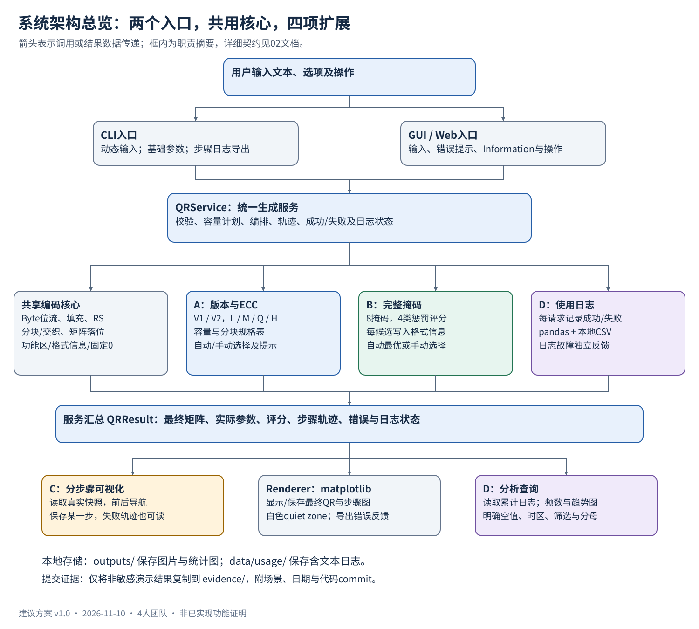
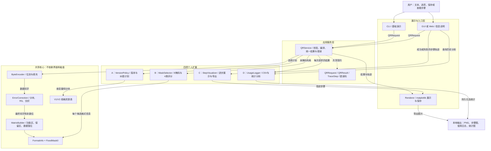
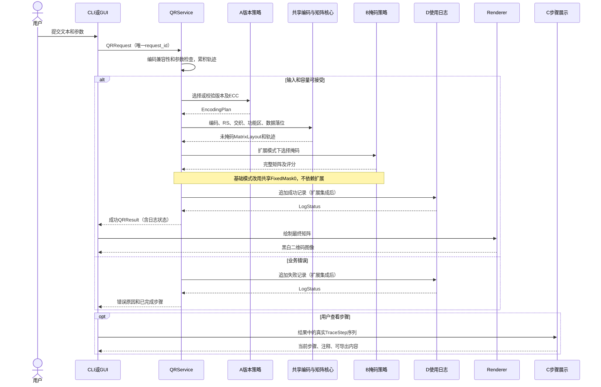

# 系统架构与接口规划

版本：v1.3　｜　日期：2026-11-11　｜　状态：建议设计，尚未实现

硬性要求以 [作业要求汇总](05_作业要求汇总.md) 为准。本设计围绕四人开发、共享基础编码、个人扩展可识别、教学机房可演示展开。

## 1. 系统边界与技术选择

| 项目 | 规划 |
|---|---|
| 运行方式 | 本地 Python 进程；CLI 与 GUI/Web 是两个入口，共用核心 |
| Python | 【硬性】3.13.9，尽量兼容课程 Anaconda3 2025.12-2 |
| 编码 | 自编 Byte Mode 编码；默认 ISO-8859-1；不支持的字符明确报错 |
| 数组 | 【硬性】numpy，二维码主体矩阵为二维 0/1 数组 |
| 数据纠错 | 【硬性】reedsolo；格式信息的纠错位自行生成 |
| 图像 | 【硬性】matplotlib；增加 quiet zone，支持 PNG 保存 |
| 日志分析 | D 的扩展使用 pandas 和本地 CSV，图表使用 matplotlib |
| GUI | 【已选方向】用户确认课堂使用PyQt5，采用PyQt5本地桌面GUI；目标环境尚待验证；以适配层隔离 |
| CI 与测试 | GitLab CI + 标准库 unittest；lint 工具和 Runner 环境待确认 |
| 首版范围 | V1/L/Mask0；扩展完成后支持 V1/V2、L/M/Q/H、八掩码评分、步骤展示和日志分析 |
| 范围外 | 网络服务、账号系统、数据库服务器、任意图像解码、外观定制、高版本QR、非Byte模式、ECI扩展 |

不使用第三方 QR 生成器替代核心实现；外部工具仅用于允许的结果对照和人工校验，引用来源。总体架构为 UML-like 分层组件图，箭头表示运行时调用或数据传递，不表示导入方向全部相同。CLI/GUI 不彼此依赖。

界面细化见 [07_PyQt5界面框架与交互规划.md](07_PyQt5界面框架与交互规划.md)。既有总览图中的“GUI/Web”是原有抽象入口，本版具体采用PyQt5桌面GUI，不实施网站；四人的真实分工与能力匹配继续暂缓。

输入/自动选择细化见 [08_输入与自动选择规则.md](08_输入与自动选择规则.md)，日志/隐私/证据细化见 [09_日志隐私与演示证据规范.md](09_日志隐私与演示证据规范.md)。当前开发暂用GitHub，正式GitLab仓库与CI要求仍保留，尚未建立新的CI。

精确的签名、字段类型、失败传递、资源生命周期和公共修改流程见 [10_公共接口与修改权限规范.md](10_公共接口与修改权限规范.md)。本文件保留概览，10作为编码前详细契约；以下负责人均为功能角色参考，不确认真实人选或平台权限。

## 2. 总体组件图

阅读路径：先看两个入口怎样使用 QRService，再看共享核心的编码顺序，最后看四个扩展的接入点。数据对象不直接承担文件写入；使用日志也不是编码步骤日志，两者分开管理。

## 3. 模块职责、输入输出与负责人

| 模块 | 输入 → 输出 | 主负责人 | 依赖与边界 |
|---|---|---|---|
| `models.py` / `errors.py` | 定义请求、计划、结果、轨迹及业务错误 | 契约协调角色待认领 | 不导入服务、界面或扩展，避免循环依赖 |
| `tracing.py` | record → 本请求只读步骤快照 | 契约协调角色待认领 | 仅内存、不跨请求共享；中途失败保留已完成步骤 |
| `byte_encoder.py` | text → bytes；data_bytes + EncodingPlan → 数据码字 | 编码功能角色待认领 | 先严格编码取得字节数，填充阶段统一接收bytes |
| `error_correction.py` | 数据码字 + 分块计划 → 交织后的码字 | A | reedsolo；V2 Q/H 不能按单块处理 |
| `matrix_builder.py` | 最终位流 + plan → MatrixLayout | B | numpy；建立保留区，按Z形顺序跳过功能区 |
| `format_info.py` | ECC等级 + mask_id → 格式位及写入结果 | B | 自行实现格式信息纠错；不调用数据RS代替 |
| `fixed_mask.py` | 未掩码布局 → Mask0结果 | B | 只改变可掩码区；服务基础模式固定使用它 |
| `version_policy.py` | 字节数 + 用户选择 → EncodingPlan | A | 查规范表，返回容量、分块和实际选择 |
| `mask_selector.py` | 未掩码布局 + plan + mask选择 → MaskSelection | B | 调用 format_info 完成候选后评分，不修改原布局 |
| `service.py` | QRService.generate_qr：QRRequest → QRResult | 集成协调角色待认领 | 实例装配可选扩展，编排核心和策略，返回错误与已完成轨迹 |
| `cli.py` | 终端输入 → 服务请求；结果 → 终端/演示文本 | D | 不重新实现编码；保持基础参数可固定 |
| `gui.py` / `information.py` | 界面输入 → 请求；结果 → 用户反馈 | 功能角色沿用原规划；真实人选待定 | PyQt5控件/事件适配，matplotlib Qt画布；展示状态不污染核心 |
| `renderer.py` | 0/1矩阵 + 输出选项 → 图像/文件 | D；C集成 | matplotlib，明确 quiet zone 和导出错误 |
| `step_visualizer.py` | TraceStep序列 → 当前步骤画面与注释 | C | 只读快照，支持上/下一步，调用renderer导出 |
| `usage_logger.py` | 请求+结果 → CSV记录；日志 → 统计数据 | D | pandas；不从核心抓取界面控件，不重新编码 |
| `qr_capacity_v1_v2.json` | version+ecc → 表项 | A；B复核 | 标明来源与分块约束，纳入测试与评审 |

## 4. 公共数据契约

下列为接口规划，不是现有 Python 实现。字段名冻结后再并行编码。枚举建议用 `Enum`，记录结构用 dataclass，配置对象尽量不可变；矩阵快照显式复制并设只读，不依赖浅层 `frozen=True` 保证数组安全。

### 4.1 QRRequest

| 字段 | 类型/范围 | 语义 |
|---|---|---|
| `request_id` | UUID字符串 | 一次用户提交的唯一ID；界面重绘不重复生成请求 |
| `timestamp` | 带时区datetime | 内存请求时间；写CSV时转ISO 8601，测试可注入固定值 |
| `text` | str | 保留原始输入，不静默改写 |
| `source` | `cli` / `gui` | 请求入口 |
| `mode` | `baseline` / `extended` | baseline固定V1/L/0 |
| `version` | `auto` / 1 / 2 | 用户指定版本；baseline必须为1 |
| `ecc_level` | `auto` / L/M/Q/H | 用户指定等级；baseline必须为L |
| `mask_id` | `auto` / 0..7 | 用户指定掩码；baseline必须为0 |
| `capture_steps` | bool | 是否保留完整步骤图；五个基础演示必须开启 |
| `options` | 允许字段组成的字典 | 步骤显示等用户选项，固定允许列表，不接受任意执行内容 |

不在请求中接受任意服务器文件路径；保存目的地由展示层安全处理。用户没有改变参数时不能把 `auto` 当作某个实际解析值写入结果。

### 4.2 EncodingPlan

字段至少含 `version`、`ecc_level`、`matrix_size`、`data_codewords`、`ecc_codewords_per_block`、`block_groups`、`total_codewords`、`remainder_bits`、`character_count_bits`、`capacity_bytes`。V1/V2 Byte模式字符数指示符均按规范处理。

`block_groups` 表示每组的块数和每块数据码字数。校验所有块数据长度之和等于 `data_codewords`；数据与ECC总数符合该版本；V2 Q/H 的数据块分别计算RS，再按规范交织。容量单位在展示时标为 bytes，不能与bits混写。

### 4.3 MatrixLayout 与 MaskSelection

`MatrixLayout` 至少包含：`modules`（尚未掩码的主体）、`reserved_mask`（功能/格式等不可掩码区）、`version`、数据落位顺序或可重建的位置说明。尺寸为 `17 + 4 * version`，不包含 quiet zone。空位只在内部布局过程使用，不进入对外最终矩阵。

`MaskSelection` 至少包含：`mask_id`、`final_matrix`、`penalty_scores`。自动时记录八个候选的 N1/N2/N3/N4 与总分；本版明确扩展模式手动时也评估八候选供比较，但使用用户指定项，并清楚显示手动选择。基础模式固定0，不要求八候选评分。

### 4.4 TraceStep

字段：`step_id`、`title`、`explanation`、`payload_type`、`payload`。`payload_type` 为 `text`、`bits`、`codewords`、`matrix`、`scores`。`payload` 只保留演示所需快照，不能存GUI控件或打开的文件句柄。每个请求由服务创建TraceCollector，阶段函数通过可选关键字trace立即登记独立快照，避免中途失败丢失全部阶段记录。

推荐步骤ID：`input_received`、`byte_encoded`、`data_padded`、`ecc_generated`、`codewords_interleaved`、`patterns_placed`、`data_placed`、`mask_applied`、`format_written`、`completed`。对于自动掩码，将候选评分作为额外步骤。失败只返回已完成步骤及错误说明，不伪造之后的步骤。

### 4.5 QRResult

字段至少含 `request_id`、`generation_success`、`byte_length`、`plan`（解析失败时为空）、`matrix`（失败时为空）、`mask_id`（未选择时为空）、`penalty_scores`、`trace_steps`、`warnings`、`error_code`、`error_message`、`error_details`、`logging_status`、`selection_policy_version`。精确类型/空值与成功不变量见10；logging_status为独立LogStatus，不通过提示文字判断分支。

`generation_success` 仅描述QR生成结果。文件保存失败、步骤图导出失败、日志写入失败分别记录并反馈，不反向把成功的编码改成失败，也不能提示“全部成功”。

## 5. 建议函数接口与调用约束

以下签名只用于分工对齐，不是要求照抄的提交代码。

| 接口 | 责任与返回 |
|---|---|
| `QRService(*, version_selector=None, mask_selector=None, usage_logger=None)` | 启动时装配可选依赖，构造不生成、不写日志；baseline不依赖扩展 |
| `QRService.generate_qr(request: QRRequest) -> QRResult` | 唯一业务生成入口；结构有效的请求返回结果，调用契约错误见10 |
| `encode_text(text: str) -> bytes` | 严格ISO-8859-1编码，取得实际字节数，不静默转换 |
| `select_plan(byte_length, version, ecc_level, mode) -> EncodingPlan` | 无界面依赖；容量不足返回规范化业务异常供服务捕获 |
| `encode_data(data_bytes: bytes, plan, *, trace=None) -> EncodedData` | 输入统一为bytes，生成正确数量的数据码字，即时登记轨迹 |
| `build_final_codewords(data_codewords: bytes, plan, *, trace=None) -> FinalCodewords` | 分块、RS、交织，返回含余数位的bitstream，标明阶段边界 |
| `build_matrix(bitstream, plan, *, trace=None) -> MatrixLayout` | 只产生未掩码布局与保留区 |
| `apply_fixed_mask_zero(layout, plan, *, trace=None) -> MaskSelection` | 基础阶段使用，不要求扩展模块先存在 |
| `select_mask(layout, plan, mask_id, *, trace=None) -> MaskSelection` | 自动/手动八掩码，完整候选评分 |
| `render_qr(matrix, render_options) -> Figure` | 返回图像对象，不隐式写文件 |
| `draw_matrix(axes, matrix, render_options) -> None` | 建议新增：在已有Axes上绘图，供PyQt5复用画布；不导入Qt或写文件 |
| `save_figure(figure, target_path, *, overwrite=False) -> SavedArtifact` | 保存或报独立IO错误，不自动关闭调用方Figure；资源由创建/持有方释放 |
| `StepVisualizer(trace_steps)` | C独立类，提供当前步骤、前后切换及导出所需数据 |
| `UsageLogger.append_attempt(request, result) -> LogStatus` | 每次请求追加一条成功或失败记录，幂等防重 |
| `UsageLogger.summarise(filters) -> UsageSummary` | 用pandas生成等级频数、成功失败趋势等分析数据 |

服务先用encode_text取得ISO-8859-1字节及长度，再选容量计划，encode_data统一接收该bytes，不再保留text/bytes两种隐含语义。阶段函数共用本请求TraceCollector；详细载荷、资源所有权和错误边界以10为准。

## 6. 基础模式与扩展模式

| 项目 | baseline | extended |
|---|---|---|
| 版本/等级 | 固定V1/L | 自动或手动V1/V2、L/M/Q/H |
| 掩码 | 固定0，使用共享基础模块 | 自动最优或手动0..7 |
| 轨迹 | 五个指定演示必须完整输出 | 按显示/演示需要保留 |
| 使用日志 | D扩展尚未完成时不依赖它 | D扩展完成后每个请求记录，含失败 |
| 界面 | CLI必须可用；GUI可选择基础参数 | GUI集成四项扩展 |

先让基础实现独立可验收，再接入扩展，不让Stage1依赖尚未完成的Stage3。最终保留可重复演示基础行为的入口或模式。

### 自动选择的明确决策

原文要求 “lowest level of error correction that can fit the user's data”，没有要求自动选择最高纠错等级，也没有完整指定版本优先顺序。

【本版暂行规则】在 `version=auto` 时按 V1→V2 检查，在 `ecc_level=auto` 时按 L→M→Q→H 检查，版本外层/ECC内层，第一个能容纳数据的组合胜出。若用户锁定某一参数，则只在另一参数的候选中查找。这样的自动等级通常为L，这是按原文“最低”等级理解，不应悄悄改为最高。容量表、四种组合、默认值、空输入策略与边界用例统一见08文档。若教师另有解释，更新规则版本、测试、Information、README和受影响证据。

用户手动锁定一个不够容量的组合时明确拒绝并提示容量；不自动把手动选择改为其他组合。字符无法编码时不通过升版本规避字符集错误。

## 7. 核心算法边界与易错点

1. 默认字符集不是UTF-8。`From α to ɷ...` 应触发不支持字符的可解释失败；较长输入应触发容量检查，不能截断。
2. 先完成模式/长度/数据、有限长度的终止位、字节对齐和交替填充，再产生RS数据纠错码字。
3. V1/L应为19数据码字+7纠错码字；扩展按真实表项处理。V2的余数位和Q/H多块纠错要单独验证。
4. V1无对齐图案；V2按对应坐标加入。V1/V2不需要V7及以上版本信息区，不要与格式信息混淆。
5. 数据落位跳过功能与保留区，列方向和时序列处理一致；dark module不可被掩码翻转。
6. 对每个候选掩码：从同一未掩码布局复制、只掩码数据区、写入该ECC/掩码对应的格式信息，形成完整候选矩阵，再计算N1/N2/N3/N4。不能把quiet zone加入惩罚评分。
7. 自动总分相同，建议选择编号最小的掩码，保证结果可重复；手动选择不被最优项覆盖。
8. 每一步矩阵都复制为快照，否则最终掩码可能把早期步骤一起改掉；C的逐步展示必须使用真实计算轨迹。
9. 服务不访问URL、不执行输入内容，也不为了“验证网址”发送网络请求。

## 8. 使用日志、步骤日志与数据保护

### 8.1 三类日志的区别

| 类型 | 目的 | 位置 |
|---|---|---|
| 编码步骤日志 | 证明每一编码阶段；供步骤可视化和五个演示文件使用 | QRResult轨迹；需提交的导出到evidence |
| 使用日志 | D扩展统计每次用户请求，包括失败 | `data/usage/qr_usage.csv`，本地不入库 |
| 技术诊断 | 调试IO或非预期错误 | 本地诊断文件，不包含必要性以外的原文和凭据 |

### 8.2 CSV字段与失败情况

最少字段：`timestamp`、`request_id`、`text_content`、`version`、`ecc_level`、`mask_id`、`user_options`、`generation_success`。建议补充 `requested_version`、`requested_ecc_level`、`requested_mask_id`、`source`、`error_code`、`schema_version`。

解析前失败时，实际version/ecc/mask留空，用户请求值单独保存；不编造实际选择。`user_options` 用JSON字符串存放允许字段；CSV用UTF-8并正确引用引号、逗号和换行。应用只作为文本读取，不执行单元格；若另做给Excel打开的导出，针对公式前缀作安全处理，保留本地原始字段不被悄悄改写。

每个真正提交到服务的请求分配一个ID，只追加一次；GUI切页、刷新图表、上一步/下一步和保存已有图像不是新的生成请求。统计以schema有效的已持久化记录按 `request_id` 去重，成功率=成功记录数/接受并已记录请求数，展示分母、筛选与日志失败导致的遗漏说明；重复ID冲突和损坏记录不能悄悄丢弃。CSV字段/空值、时间和读取约定以09文档为细化依据。

### 8.3 保护与失败反馈

生成前说明会在本机记录输入原文、位置、用途及清除方法，提醒不要输入密码或敏感信息；用户不接受时可不提交请求。不能一边承诺“不保存文本”一边写入完整日志，也不能为隐私静默删除作业要求的 `text_content` 字段。

日志写入失败要在界面提示“二维码已生成，但使用记录保存失败”，不得无声吞掉。单机首版串行追加，进程内锁防止同一进程并发写入；多进程同时运行不作为首版支持范围，启动说明中写明限制。CI使用临时CSV，清除日志使用明确入口和二次确认（避免误删既有使用历史）。

## 9. 模块调用时序

## 10. 架构验收

- CLI/GUI相同请求的编码结果一致；非预期的编码分支不藏在界面回调里。
- 移除UI后，核心和扩展算法可以独立测试；不要求CI打开浏览器或弹窗才能跑所有测试。
- 四个个人模块被最终应用实际调用，README能指出入口、依赖、作者和集成证据。
- 基础模式保持固定规格；扩展模式完整暴露参数和实际解析值。
- 录屏包含同一应用中四项扩展一起工作的场景，不能拼接四个互不相干的独立脚本冒充集成。
- 所有接口、图和最终代码一致；实现变化要更新本规划，最终用户手册只描述已验收功能。
