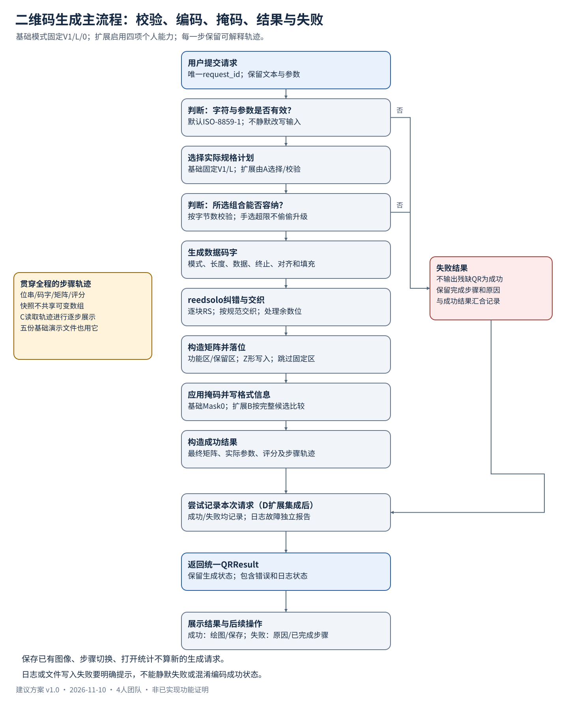
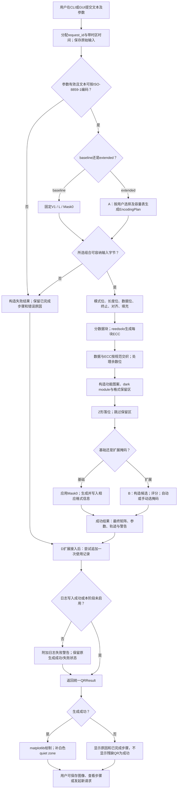
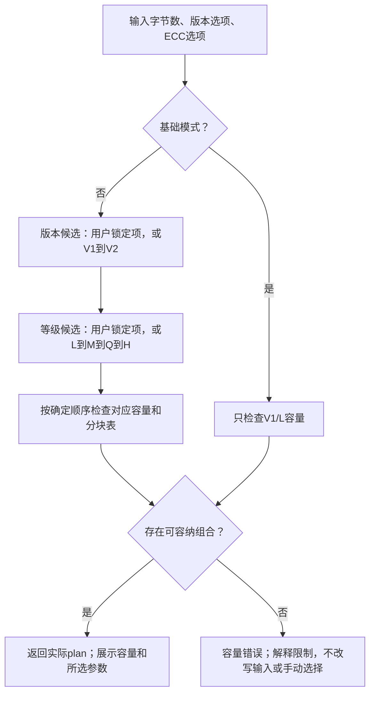
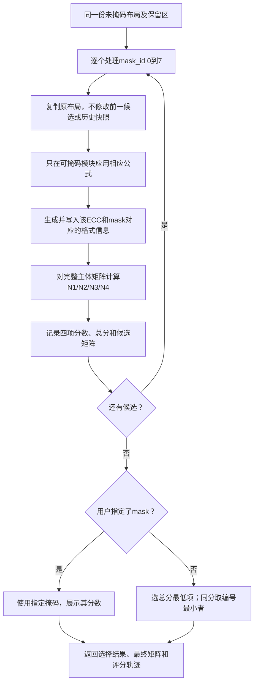
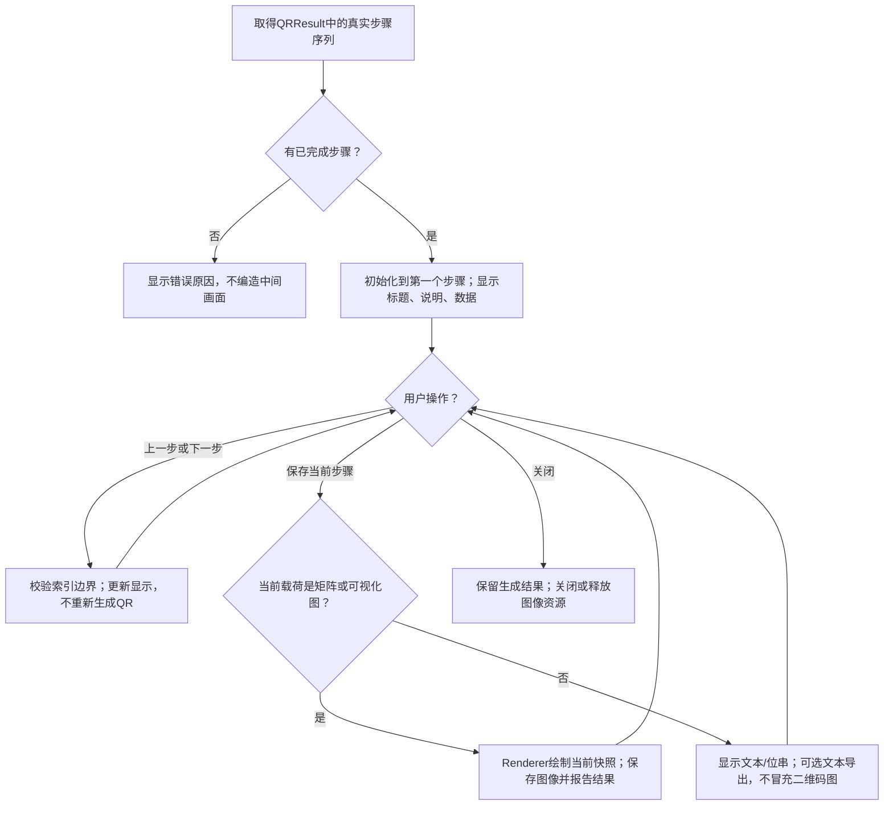
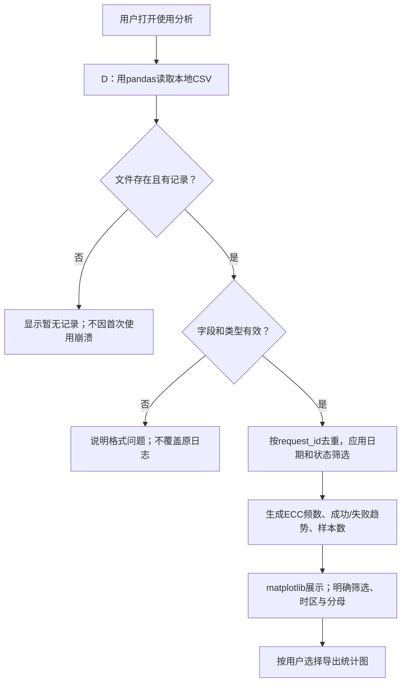
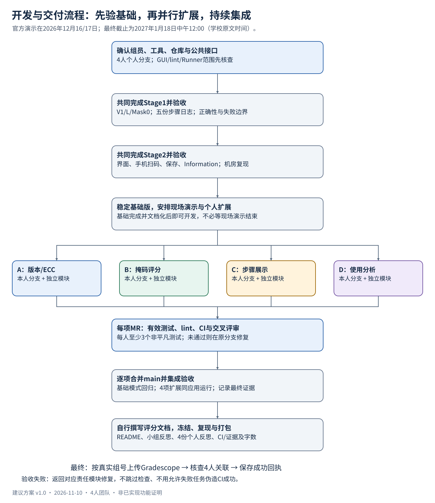
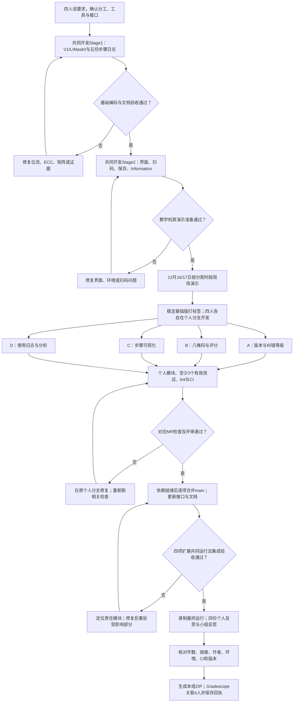

# 业务流程与开发流程

版本：v1.0　｜　日期：2026-11-10　｜　状态：拟议流程，尚未实现

接口及模块名统一遵循 [系统架构与接口规划](02_系统架构与接口规划.md)。本文件用流程图说明运行顺序和失败分支，不把图中步骤视为已经完成的功能。

## 1. 二维码生成主流程

核心内部若发生业务错误，同样进入失败结果分支。发生文件写入错误时独立反馈，不把已有生成结果悄悄撤销。基础阶段不要求D的扩展先存在，五份步骤日志由共同的TraceStep导出机制提供。

## 2. 自动或手动选择版本与纠错等级

上述默认顺序属于建议方案：原文“最低纠错等级”需要与组内/教师确认。手动锁定V1/H时，即使V2/L能装下也不能无提示替换。字节编码失败在选择计划之前报错。

## 3. 八掩码选择与评分

N1关注同行/列连续同色模块，N2关注同色2×2，N3关注类似定位图案序列，N4关注黑白比例；具体公式按规范实现并独立验证。quiet zone不参加掩码评分。

## 4. 步骤展示、图像保存与使用分析

### 4.1 步骤展示

C扩展应显示当前步骤序号/总数，并在首尾禁用越界导航。失败结果也可以查看已完成步骤。中间图需要明确标“中间步骤，可能不可扫描”，最终图才提示用于扫码。

### 4.2 保存最终二维码

1. 用户从已有成功结果选择保存；失败结果不开放“保存最终QR”。
2. 选择允许的图像格式和路径，文件名默认使用request_id，不采用用户文本。
3. 文件已存在时先提示是否覆盖，拒绝覆盖则保留原件。
4. 使用统一renderer输出含quiet zone的图像；成功后显示实际路径，失败则显示权限/路径/空间等错误。
5. 保存已有图像不算新的生成请求，不重复写一条使用记录。

### 4.3 使用日志与分析

解析前失败的请求，其实际ECC为空；等级图可单列“未解析/失败”，或明确说明只统计已解析等级的记录。不同图采用不同分母时必须写清，不把失败记录从成功率分母中静默删掉。

## 5. 团队开发与交付流程

个人扩展的正式开发安排在基础阶段完成并文档化之后；前期可以先读规范、明确接口和分析风险，不需要等到12月现场演示后才开始准备。实际进度允许时，可在Stage2验收后提前开发扩展，图中现场演示节点不构成强制等待要求。

建议合并顺序：先共享契约，再A的完整规格计划，再B的掩码选择，C/D使用稳定轨迹和结果契约接入；C/D可并行，但最终由一次完整集成验收确认。不要到最终截止前才第一次合并四人的代码。

## 6. 流程的完成判据

| 流程 | 完成的可见证据 |
|---|---|
| 基础生成 | 五份独立演示文件，包含正确输出或合理失败及失败前步骤 |
| 界面生成 | 输入、错误反馈、黑白显示、真实手机扫码、保存及Information |
| 版本/ECC | 手动与自动、容量临界值、多块纠错、实际参数展示 |
| 掩码 | 八个候选、四类分数、自动最优、手动选择和同分规则 |
| 步骤显示 | 使用真实轨迹导航、首尾边界、保存某一步、失败轨迹 |
| 使用分析 | 成功/失败均记录、字段完整、防重、累计数据图表与空日志处理 |
| 最终交付 | main含4项扩展；CI成功；文档和证据链接可用；归档能在干净环境配置 |
