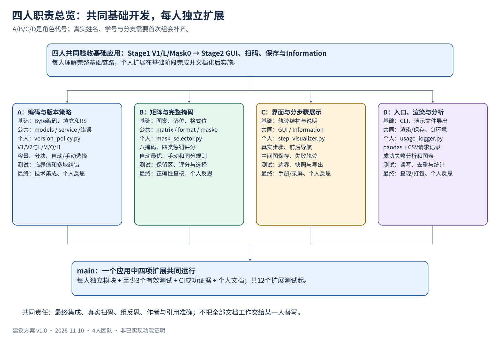

# 四人分工与里程碑

版本：v1.0　｜　日期：2026-11-10　｜　状态：建议分工，姓名与学号待补

本组共4人，符合正式说明允许部分小组4人的安排。下面用A/B/C/D作为角色代号，不虚构真实人名或学号。每人都参与共同基础开发，并独立完成一个不同的个人扩展；“组长”或“写文档”不替代个人模块。

2026-11-10补充：按用户要求，真实分工及能力匹配暂缓；本文件保留功能角色参考，不新增人员安排。界面框架已按课堂工具确定为PyQt5，详见 [界面规划](07_PyQt5界面框架与交互规划.md)，原表中的框架核查转为具体版本与机房兼容性验证。

## 1. 角色确认表

| 角色 | 真实姓名 | 8位学号 | 个人扩展 | 个人分支 |
|---|---|---|---|---|
| A | 待填 | 待填 | 版本与纠错等级 | `feature/<student_id>-version-ecc` |
| B | 待填 | 待填 | 八掩码与惩罚评分 | `feature/<student_id>-mask-selection` |
| C | 待填 | 待填 | 分步骤可视化 | `feature/<student_id>-step-visualizer` |
| D | 待填 | 待填 | 使用日志与统计分析 | `feature/<student_id>-usage-analytics` |

## 2. 各阶段分工与交付物

| 阶段 | A | B | C | D |
|---|---|---|---|---|
| 前期准备 | 整理容量/分块表和编码规范；维护接口契约 | 整理矩阵/格式位/掩码规范；复核容量表 | 核查允许的GUI框架；画界面草图和步骤结构 | 核查机房环境/CI；设计证据目录和输入清单 |
| Stage1共同基础 | Byte模式、填充、V1/L的RS封装；统一服务与错误 | 功能区、保留区、Z形落位、格式信息和固定Mask0 | 共同实现TraceStep及阶段注释；检查五个输入的失败路径 | CLI入口、步骤日志文件导出、基础测试组织与运行入口 |
| Stage2共同界面 | 容量/字符错误说明、参数校验、Information技术内容 | 矩阵正确性复核与手机扫码对照，避免功能区/掩码错误 | GUI/Web输入输出、错误提示、Information入口和交互 | matplotlib渲染、quiet zone、文件保存、机房环境与演示证据 |
| Stage3个人扩展 | `version_policy.py`；V1/V2与L/M/Q/H，核对各等级RS参数 | `mask_selector.py`；八掩码、四评分、自动/手动与日志 | `step_visualizer.py`；真实轨迹、导航、说明、步骤导出 | `usage_logger.py`；CSV记录、pandas分析和统计图接入 |
| 测试/CI | 自己扩展≥3个非平凡测试；规范表临界值 | 自己扩展≥3个非平凡测试；独立评分期望值 | 自己扩展≥3个非平凡测试；状态、快照及导出 | 自己扩展≥3个非平凡测试；IO与统计；维护CI公共配置 |
| 最终交付 | 主导技术集成与README技术核对；自己写个人反思 | 主导正确性复核与范式/缺陷定位；自己写个人反思 | 主导最终演示录制与界面手册组织；自己写个人反思 | 主导证据索引、环境复现及打包；自己写个人反思 |

小组反思由四人共同提供真实事实并共同确认；可以由一人整理，但不能由该人替其他人编造经历。四人均应能解释基础生成与界面，不限于自己模块。

## 3. 公共文件负责人和交叉评审

| 公共部分 | 协调负责人 | 必须参与的评审者 | 协作规则 |
|---|---|---|---|
| models/errors/service | A | B/C/D | 接口变更先发MR，说明所有调用方影响 |
| QR规格表和多块ECC | A | B | 两人独立核对数据码字、ECC、分块和余数位 |
| matrix/format/fixed_mask | B | A | 不破坏基础模式；候选格式位参与评分 |
| gui/information | C | D；A复核容量提示 | GUI不重写算法；避免自动重绘产生重复请求 |
| renderer | D | C | 步骤导出和最终图共用渲染接口 |
| CI/requirements/environment | D | A；全员验证 | lint工具/Runner先确认，变更后复验教学机房 |
| 最终README | C组织 | A/B/D逐项核实 | 内容依照真实实现，各自撰写负责事实 |
| 提交归档与证据链接 | D | C | 一人打包、一人核对，四人确认关联和回执 |

每人的个人模块建议由下一位评审：A→B、B→C、C→D、D→A（箭头表示前者评审后者）。专业风险可以增加A/B互审，但不要让单人包办全部评审。

## 4. 每人独立验收任务

### A：版本与纠错等级

交付：版本/ECC选择模块、完整规格表、相关核心适配、界面参数接入、特征日志、至少3个有效测试、CI成功证据、个人文档。

测试重点：不同组合容量的临界值/超限；自动与手动选择的确定性；V2 Q/H单块RS与7个余数位对照；通用交织用独立小样本验证。独立模块必须被最终服务实际使用，不能只留下孤立容量查询函数。

### B：完整掩码与评分

交付：八掩码公式、四类惩罚评分、候选比较、自动/手动选择、用户可见评分、至少3个有效测试、CI证据、个人文档。

测试重点：保留区不改变且输入布局不被修改；用手工小矩阵验证四评分中的真实分支；独立候选总分验证最优选择与同分规则。完整QR评分还需验证格式位随候选掩码变化。

### C：分步骤可视化

交付：独立StepVisualizer类或函数、真实轨迹展示、步骤说明、手动导航、可视化步骤导出、至少3个有效测试、CI证据、个人文档。

测试重点：首尾导航与越界保护；前一步矩阵不会随后一步修改；导出对应所选步骤而非总是最终图；失败轨迹可展示。单元测试尽量针对状态/数据，不强依赖具体GUI窗口。

### D：使用日志与分析

交付：独立UsageLogger、UTF-8 CSV记录、成功与失败路径、pandas统计、图表接入、至少3个有效测试、CI证据、个人文档。

测试重点：含逗号/引号/换行文本读回一致且字段完整；重复ID不重复计数、失败请求保留；已知小数据集的频数与成功率；日志不可写时错误反馈不破坏生成结果。使用临时目录，不改真实日志。

## 5. 计划里程碑与验收门槛

以下除“官方节点”外均为建议的组内日期，不是教师新要求。官方时间按学校原文记录，需核对时区与实际分配时段。

| 日期/区间 | 性质 | 目标 | 验收门槛 |
|---|---|---|---|
| 11月10—12日 | 组内计划；12日中午为官方组队节点 | 确认4人、分工、私有仓库、工具与接口 | 成员表补齐；各有个人分支；无未说明的框架依赖 |
| 11月13—17日 | 组内计划 | V1/L/Mask0贯通第一版 | `known`位流、ECC、矩阵能够逐步解释；模块可独立检查 |
| 11月18/19日 | 官方第8周检查 | 汇报真实进度与阻塞 | 有当前代码、分工及下一步，未完成项明确 |
| 11月20—27日 | 组内计划 | Stage1完成并文档化 | 五份日志齐全；字符/容量错误合理；基础测试通过 |
| 11月28日—12月1日 | 组内计划 | GUI、图像保存、Information可用 | 界面复用基础服务，手机能扫基础图 |
| 12月2/3日 | 官方第10周反馈演示 | 获得反馈并记录待修复项 | 展示真实进度，记录反馈、负责人和修复截止 |
| 12月4—11日 | 组内计划 | Stage2验收，教学机房复现 | 从仓库到机房运行成功；错误/保存/安全说明完整 |
| 12月12—15日 | 组内计划 | 正式演示彩排 | 全员能解释；五日志、扫码、保存、Information可快速定位 |
| 12月16/17日09:00—11:00 | 官方第12周演示 | Stage1/2现场评分 | 按本组实际时段在教学机房演示 |
| Stage2验收后—1月5日 | 组内计划 | 四项个人扩展开发完成 | 自己模块、测试、个人功能证据和CI均完成；可提前逐项合并 |
| 1月6—10日 | 组内计划 | 最终合并与回归 | 4项扩展在同一应用共同工作；保留基础模式 |
| 1月11—14日 | 组内计划 | 最终录屏、README及反思 | 文档描述真实实现；来源、作者、链接和字数可核查 |
| 1月15—17日 | 组内计划 | 冻结、复现、打包与提前提交 | main最新CI绿灯；归档解压检查；4人确认提交关联 |
| 2027年1月18日12:00 | 官方最终截止 | Gradescope提交完成 | 获得成功回执，文件和组员关联正确 |

跨年日期：表中11、12月为2026年，1月为2027年。扩展可以在Stage2完成并文档化后开始，不强制等到正式演示结束。假期可用时间需组内确认，不假定每人每天在线。

## 6. 工作量与会议建议

正式说明给出每人约24小时的典型参考，4人总计约96人时，不是强制工时上限。初始预算建议每人：基础8小时、界面4小时、扩展7小时、测试/CI2小时、文档2小时、演示1小时。若RS参数核验或GUI环境超出预算，应提前调整安排，保留每人独立扩展的完整性。

建议每周一次短会，基础接口冻结、Stage1验收、Stage2验收、首次合并、最终冻结各加一次检查。记录真实日期、出席、决策及待办；重要接口变更在仓库issue/MR中留下文字，避免只在口头聊天中确定。

## 7. 风险与应对

| 风险 | 应对 |
|---|---|
| A的版本扩展复杂度较高 | B复核规格表，D承担CI/打包；先完成基础编码，再逐级加入分块 |
| B/C/D等待接口 | 先冻结models和小型非敏感fixture，允许针对契约并行开发 |
| GUI工具或lint未获允许 | 前期核查课堂依据或请求教师批准；不临时引入陌生框架 |
| 某项扩展延期 | 尽早沟通并记真实贡献；配对排障可用，但保留本人独立模块和开发记录 |
| 个人代码只能单独运行 | 每个MR都展示主应用中的真实调用和影响；不要四人各交一个独立程序 |
| 假期失联或联系困难 | 及早确定可用时间；影响合作时按原文尽快向模块负责人报告 |

投入权重在小组反思中按实际情况记录。100%表示正常充分投入，不是4人共享总和100%；不能预先把A/B/C/D各写25%。
